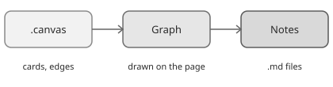

# Graph

The graph shows a canvas: groups, cards and labelled edges.

You can pan, zoom, fit the view and use the minimap. In View mode clicking a card opens its note, and a sub-map card opens its canvas. In Edit mode cards can be dragged and edges drawn from the card sides. Zoom limits and spacing are covered in [[zoom-and-layout]].

The picture shows the three things the page works with. The graph is drawn from the canvas, and the notes it points to are shown by [[note-editor]].
