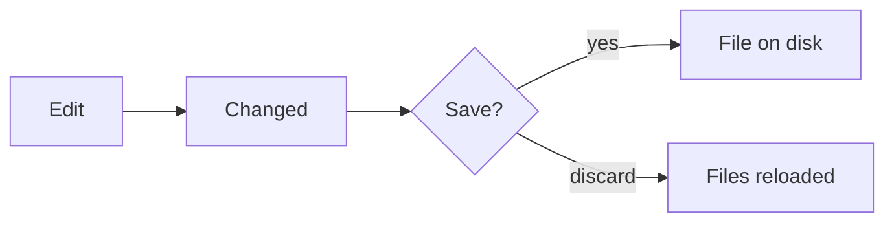

# Save flow

Edits are held in the page until Save writes them to the project folder.

Each edit marks the file as changed. Save sends every changed file to the server started by [[cli]] serve, which writes them to the folder. Discard drops the changes and loads the files again. When the project is in memory (New project in the browser, or on a published site) there is nothing to write to, so the way out is an export; see [[zip-sharing]].

Leaving a project with unsaved changes asks Save, Discard or Cancel.
